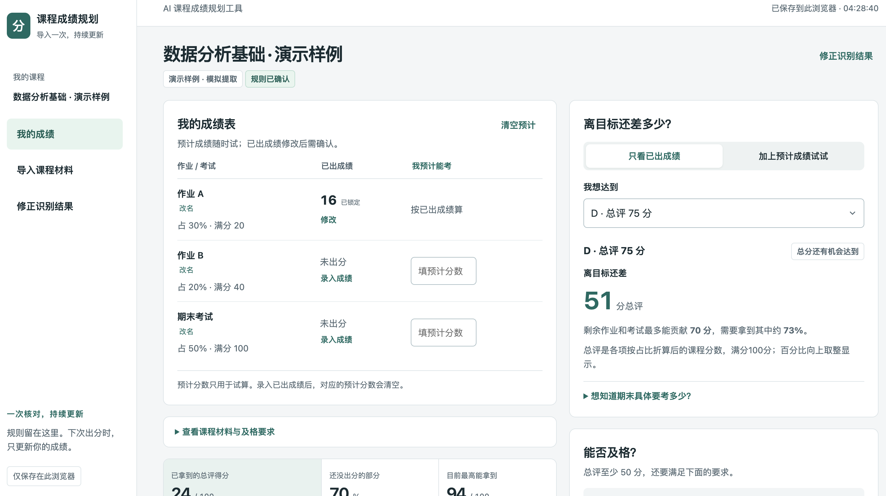

# 课程成绩规划 Demo

## 项目访问

- **[在线体验 Demo](https://xingyuli2.github.io/ai-course-grade-planner/)**：直接打开，无需安装或 API Key

配套材料使用“模拟提取”，计算与保存真实运行。课程记录保存在当前浏览器，不会同步给其他访问者；本机版与在线版的记录互不迁移。

## 项目截图

**演示样例成绩页：已出成绩锁定展示，可查看目标差距并填写预计分数试算。**



---

## 1. 项目简介

这是我的 AI 产品经理学习作品集，围绕课程成绩规划练习需求分析、产品设计与验证。

课程成绩规划 Demo 面向学生，支持评分规则提取、目标试算与分数持续更新。用户从课程材料生成成绩表，核对规则后填写预计分数，查看距离目标还差多少；实际成绩公布后，在同一份记录中继续更新。

当前版本用配套截图和文字模拟规则提取，确定性计算、成绩修改确认与浏览器本地保存真实实现。自己的新材料可以预览，尚未接入真实模型识别。

## 2. 为什么做这个项目？

课程成绩陆续公布时，学生需要反复整理考核占比、历史成绩和额外及格要求，再计算剩余目标。这个项目从个人算分经历出发，尝试把一次次问答变成持续维护的课程记录。

重点解决三个任务：

- **首次整理**：从材料得到可核对的成绩表，减少从空表逐项录入的负担。
- **目标试算**：分清已经拿到的成绩与假设成绩，比较剩余要求。
- **后续更新**：保留规则和历史记录，每次出分只更新对应项目。

核心产品假设是：持续记录能减少二次更新时的重复整理。当前已有原型反馈与功能验证，效果仍需通过同学任务观察评估。

## 3. MVP 核心功能

| 功能模块 | 当前功能 |
| --- | --- |
| 评分规则提取 | 导入配套演示截图／文字，模拟提取后生成成绩表；自己的材料仅预览 |
| 结果核对 | 生成后核对项目、占比、满分与及格要求，按需修正 |
| 成绩保护 | 已出成绩默认锁定，编辑、核对并确认后更新；取消保留原值 |
| 预计试算 | 预计成绩可直接调整，实际与预计分开计算 |
| 目标要求 | 显示剩余整体要求；只有一项未知时倒推该项分数 |
| 及格检查 | 分开判断总评与单项最低分，提示不可达或未满足条件 |
| 持续保存 | 同一浏览器保存一门课程，刷新后继续更新；异常保存给出提示 |

核心流程为 **材料导入 → 生成成绩表 → 预计试算 → 持续更新**；规则修正在生成之后，不要求前置手工建课。

## 4. AI 产品能力映射

| 设计主题 | 当前实现 | 下一步验证 |
| --- | --- | --- |
| 材料理解 | 配套样例采用固定候选结果，明确标为模拟提取 | 用真实材料执行独立模型实验 |
| Prompt 设计 | 已定义提取角色、输入、约束、来源引用和输出结构 | 保留首次输出，逐字段核对错误 |
| 结构化输出 | 将项目、权重、满分、实际／预计与最低分分开表达 | 检查字段含义与引用，核对后再计算 |
| 状态管理 | 待核对规则、实际／预计、修改草稿与已保存记录分离 | 补齐浏览器异常路径检查 |
| 结果可靠性 | 确定性加权与倒推，缺失、冲突或不支持规则阻止正式结论 | 继续用独立人工基准覆盖边界 |
| 质量评测 | 自动检查、浏览器任务、模型提取与用户观察分别设计 | 执行模型与同学观察，记录真实结果 |

## 5. 产品体验流程

```text
选择配套截图或文字
→ 模拟提取，直接生成成绩表
→ 核对规则，有误时按需修正
→ 输入预计成绩，查看剩余要求
→ 实际出分后录入、核对并确认
→ 本地保存，下次打开继续更新
```

用合成课程体验：A占30%、实际16/20；B占20%、满分40；期末占50%、满分100，且至少50分。

| 操作 | 目标总评75时的结果 |
| --- | --- |
| 只有A实际16分 | 实际已获24分，还差51分；剩余最多贡献70分，整体约需73% |
| B填预计30分 | 实际已获仍为24分；按当前假设，期末需72分 |
| B确认录入实际32分 | 实际已获40分；期末需70分，B预计清空 |
| B拟改31分后取消，再刷新 | B仍为32分，A仍为16分 |

以上核心操作已在实际浏览器中走查；[完整验收清单](docs/browser-checklist.md)中的其他路径继续补测。

## 6. 技术栈与本地运行

- 原生 HTML / CSS / JavaScript ES modules
- BigInt 有理数进行精确计算
- localStorage 保存结构化课程记录
- Python 3 标准库提供本机静态服务
- Node.js 运行自动检查，无第三方 npm 依赖

```bash
git clone https://github.com/XingyuLi2/ai-course-grade-planner.git
cd ai-course-grade-planner
python3 serve.py
```

打开 [本机 Demo](http://127.0.0.1:8000/dist/)，保持终端运行。无需构建或 API Key；不要直接双击 HTML。端口占用时可用 `--port 8001`，但不同浏览器、域名和端口不共享记录。

重跑自动检查（本轮使用 Node v24.22.3）：

```bash
node --experimental-vm-modules tests/run-all.mjs
```

加 `--write` 可更新结果 JSON。[测试说明](tests/README.md)

## 7. 项目结构

```text
ai-course-grade-planner/
├── assets/screenshots/    # 真实运行截图，合成演示课程
├── docs/                 # 产品、Prompt、状态、计算和验证文档
├── learning-notes/       # 结合项目场景的学习与复盘
├── prompts/              # 独立模型实验用提取Prompt
├── evaluation/           # 合成输入、人工答案和实验记录模板
├── dist/                 # 手写网页源码，必须保留
├── tests/                # 自动检查与实际结果
├── serve.py              # 本机启动脚本
└── README.md
```

## 8. 项目文档

### 产品与 AI 设计

| 文档 | 内容 |
| --- | --- |
| [产品需求](docs/product-requirements.md) | 定位、用户、痛点、目标、范围与功能需求 |
| [产品案例](docs/product-case.md) | 问题拆解、关键取舍、流程迭代与交付证据 |
| [Prompt 设计](docs/prompt-design.md) | 提取职责、字段、约束、核对与实验设计 |
| [状态设计](docs/state-design.md) | 规则状态、成绩状态、草稿与持续保存 |
| [计算契约](docs/calculation-spec.md) | 公式、最低分要求、显示精度及12个人工基准 |
| [评测指标与验证](docs/validation.md) | 产品体验、提取质量、异常处理与测试用例 |
| [演示脚本](docs/demo-walkthrough.md) | 三个关键场景与演示顺序 |

### 学习与验证记录

| 文档 | 内容 |
| --- | --- |
| [项目学习笔记](learning-notes/decisions.md) | 从具体决策理解结构化输出、状态与评测 |
| [自动检查记录](docs/verification-portfolio-2026-11-25.md) | 93项检查的方法、环境与结果 |
| [独立模型实验](evaluation/README.md) | Prompt、5个合成案例及待执行实验 |

## 9. 当前版本

**单课程交互演示版 · 2026-11-25**

| 交付内容 | 状态 |
| --- | --- |
| 材料导入、成绩表、预计试算、确认修改与本地保存 | 已实现；提取为明确标注的模拟 |
| 自动检查 | 93/93通过：计算52、存储13、成绩编辑11、应用事件14、启动3 |
| 浏览器交互 | 已走查确认、试算、录入、取消与刷新恢复；完整验收待补 |
| 真实模型实验 | Prompt与5个合成案例已备，尚未执行 |
| 同学观察 | 尚未开始 |
| 发布 | GitHub代码与截图已上传；GitHub Pages Demo已发布，首页与12个网页资源通过公开访问核验；线上交互复测待补 |

自动检查中的存储与事件使用替身，不能作为模型准确率或完整浏览器验收。当前仅支持100分加权总评、明确原始满分和单项 `>=` 最低分；其他规则提示待核对或暂不支持。

## 10. 后续规划

1. 补齐材料生成、规则修正、异常保存、替换保护和键盘操作的浏览器验收，完成演示录屏。
2. 用固定Prompt进行独立模型实验，保留首次回复并与人工答案逐字段比对。
3. 观察同学完成二次更新与预计试算，记录完成情况、求助和结果理解，再决定迭代方向。

真实网页模型接入、多课程和云同步留待后续评估。原图不持久保存，当前没有数据备份功能。

## 11. 项目沉淀

项目围绕一个持续使用的学生任务，形成了需求、流程、Prompt、状态和验证之间的对应关系：

- 从反复算分的场景中确定“首次整理”和“二次更新”两个任务。
- 根据原型反馈，把前置手工建课调整为生成后核对与修正。
- 将材料提取与确定性计算分工，明确结构化字段与规则边界。
- 用实际／预计分离、草稿确认和保存状态保护持续记录。
- 用人工基准、自动检查、浏览器走查与待执行实验逐层验证产品。
