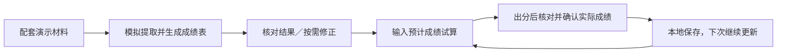

# AI 课程成绩规划工具

**材料导入 → 生成成绩表 → 预计试算 → 持续更新。**

面向学生的单课程交互 Demo：把课程规则和已出成绩留下，下次出分只更新成绩，再看距离目标还差多少。需求来自项目发起人的个人经历，尚未通过同学观察验证。

> 当前是演示版：配套合成截图／文字采用明确标注的“模拟提取”；计算、成绩修改确认和浏览器本地保存真实实现。自己的新材料仅预览，尚不能真实识别。无 API、账号或云同步。

[产品案例](docs/product-case.md) · [产品需求](docs/product-requirements.md) · [状态设计](docs/state-design.md) · [验证证据](docs/validation.md) · [Prompt](prompts/extract-rules.md)

## 先看一次完整任务



没有逐项手工建课前置步骤。修正入口在成绩表生成后；实际成绩默认锁定，预计成绩可直接调整。

| 合成样例中的操作 | 页面应表达什么 |
| --- | --- |
| A 占30%、实际16/20，目标总评75 | 实际已获24分，还差51分；剩余最多贡献70分，整体约需73%（向上取整显示） |
| 给 B（占20%、满分40）填预计30 | 实际已获仍是24分；按这个假设，期末至少72/100 |
| B 实际出分32，核对后确认 | B预计清空，实际已获40分；期末至少70/100，A记录保留 |
| 修改 B 后取消 | 原实际分数不变；确认后才保存新值 |

期末占50%，另有最低50分要求。上述均为合成规则，不是学校标准；总评目标与额外及格要求分别判断。

**截图与录屏：待补。** 本轮浏览器控制未取得界面证据，因此没有用设计稿或参考截图冒充运行截图。[演示与取证步骤](docs/demo-walkthrough.md) 已写好，实际验收状态见 [浏览器清单](docs/browser-checklist.md)。仓库内 [demo-course.svg](dist/demo-course.svg) 是合成输入材料，不是产品截图。

## 本地运行

需要 Python 3；不需要前端框架、API Key 或构建步骤。

```bash
git clone https://github.com/XingyuLi2/ai-course-grade-planner.git
cd ai-course-grade-planner
python3 serve.py
```

打开 [本机课程 Demo](http://127.0.0.1:8000/dist/)，保持终端运行；结束时按 `Ctrl+C`。已经下载源文件时，在包含 `serve.py` 的文件夹运行最后一行即可。不要直接双击 HTML。

服务只监听本机。端口占用时可用 `python3 serve.py --port 8001`，但不同浏览器、域名或端口不共享记录；清理站点数据会丢失记录，原图不持久保存。保存课程、实际／预计成绩及目标定义；当前选中的目标选项不单独持久化，刷新默认最后一个目标。

## 三分钟体验

1. 选择“演示截图”或“演示文字”，点击“生成成绩表”。注意“演示样例 / 模拟提取”标识。
2. 核对项目、占比、满分与及格要求，点击“以上信息无误，开始试算”。名称可直接改；其他规则从“修正识别结果”按需调整。
3. 选择 D（75分），给 B 填预计30，查看期末要求72；预计值不会变成实际成绩。
4. B 点“录入成绩”，填32，进入下一步核对，再确认。查看期末要求70，以及B预计清空。
5. B 点“修改”，输入31再取消，检查仍为32；刷新同一地址，继续查看已保存记录。

这也是可复现的演示脚本。自动检查支持相应计算和事件逻辑，完整真实浏览器验收仍待完成，不把这份步骤表当通过记录。

## 为什么这样设计

- **先生成再修正**：用户希望省去整理材料的负担，初版的手工建课被移出主流程。
- **实际与预计分开**：预计是试算假设，不应增加实际已获分数；未知分数也不等于零分。
- **已出成绩锁定并确认修改**：成绩可能调整，需要纠正入口；草稿取消时保留原值，确认只更新该项。
- **提取与计算分工**：未来模型只产出待核对规则，确定性逻辑负责加权、倒推与门槛判断；缺失、冲突或不支持的规则不能默默丢弃。

支持100分总评、明确权重与原始满分、单项 `>=` 最低分条件。调分曲线、去掉最低成绩、复杂 OR 条件等超出首版范围，详见 [计算契约与12个人工基准](docs/calculation-spec.md)。

## 已验证什么

截至2026-11-25：

| 层级 | 实际状态 | 证据 |
| --- | --- | --- |
| 自动检查 | 93/93通过：计算52、存储13、成绩编辑11、应用事件14、启动3 | [本轮重跑记录](docs/verification-portfolio-2026-11-25.md)、[测试与原始结果](tests/README.md) |
| 真实浏览器 | 核心流程实现，完整交互／视觉验收未完成 | [待验收清单](docs/browser-checklist.md) |
| 模型实验 | Prompt、5个合成输入、人工答案、记录模板已备；全部未运行 | [实验准备](evaluation/README.md) |
| 用户观察 | 有发起人反馈与实际迭代；同学观察未开始 | [产品案例](docs/product-case.md) |
| 网页模型接入 | 未接入，配套材料模拟提取 | [导入实现](dist/import-view.mjs) |
| 发布 | 已上传至公开GitHub仓库；公网Demo尚未部署 | [发布记录](docs/repository-release.md) |

93项是自动检查数，包含内存存储与 DOM 替身；不是模型准确率、用户测试人数或完整浏览器验收。历史记录保留原日期与当时范围。

重跑全部检查需要支持 ES modules、BigInt 和 VM modules 的 Node.js；本轮实测 Node v24.22.3，无需安装 npm 包：

```bash
node --experimental-vm-modules tests/run-all.mjs
```

加 `--write` 可刷新5份结果 JSON。浏览器 [检查页](http://127.0.0.1:8000/tests/) 仅包含前三组76项，另外17项依赖Node VM。

## 仓库导览

| 位置 | 内容 |
| --- | --- |
| `dist/` | 手写网页源码；必须保留，不是可丢弃构建产物 |
| `serve.py` | Python标准库本机静态服务 |
| [产品需求](docs/product-requirements.md) / [产品案例](docs/product-case.md) | 场景、范围、取舍、反馈和贡献划分 |
| [状态设计](docs/state-design.md) / [计算字段](docs/calculation-types.md) | 何时可计算、修改、确认和保存 |
| [验证说明](docs/validation.md) / `tests/` | 分层验证、独立人工答案与实际结果 |
| `prompts/` / `evaluation/` | 规则提取Prompt、合成输入与尚未执行的模型实验 |
| [项目取舍笔记](learning-notes/decisions.md) | 用项目例子解释判断，附理解自检 |
| [参考映射](docs/reference-map.md) | 实际阅读来源、组织方式与版本差异 |

## 后续

下一步补真实浏览器与截图／录屏，再执行独立模型实验和同学任务观察；缺少API不阻止当前演示与公开文档。代码上传和公网Demo部署分别核验。
