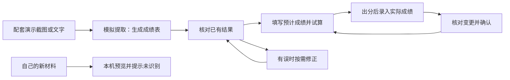

# 产品需求：AI 课程成绩规划工具

更新：2026-11-25。当前产品是单课程交互 Demo：配套材料模拟提取，计算、成绩确认修改和浏览器本地保存真实实现。本文说明需求与验收条件，验收结果以 [验证记录](verification-import-demo-2026-11-25.md) 及其后续记录为准。

## 问题从哪里来

项目发起人在课程出分后，需要把评分规则、已有成绩和目标重新整理给 AI，才能询问剩余考核需要多少分。本项目围绕这个个人场景，探索把一次性问答变成可持续更新的成绩记录。

这是发起人的经历与反馈，尚未通过同学访谈证明具有普遍性。当前没有时间对照数据，不声称节省了多少时间。

目标用户是需要反复更新课程成绩、比较个人目标的学生。一次核心任务是：导入材料生成成绩表，核对规则，填一个预计成绩看变化；下一次出分后打开同一记录，补入实际成绩继续计算。

## 核心流程

新课程不要求从空白表单逐项建课。生成后修正用于纠正结果，不能重新成为每位用户都要完成的前置步骤。自己的新材料当前只预览，不生成另一份演示材料的答案。

## 本轮必须支持的行为

| 用户任务 | 产品行为 | 可检查的条件 |
| --- | --- | --- |
| 从材料开始 | 配套截图、配套文字均可生成成绩表；持续显示演示与模拟标识 | 点击生成后直接出现考核项目、已有成绩和预计输入框 |
| 核对并纠正 | 首次计算前核对一次；名称可改，其他规则进入修正页 | 改名保留项目 ID 和成绩；规则取消不改已接受记录 |
| 查看剩余要求 | 只按实际成绩计算差额、理论最高分、总分可达性 | 多项未知显示合计要求；唯一未知项可倒推该项原始分数 |
| 比较预计情况 | 预计与实际分开；列出试算依赖的假设 | 预计变化不改变已取得的总评分；同项实际存在时只算实际 |
| 更新已出成绩 | 已出成绩默认锁定；录入、修改、清除均先编辑，再核对，最后确认 | 取消或 Esc 不改原值；确认仅清除本项旧预计，保留其他成绩 |
| 下次继续使用 | 保存规则、实际、预计与目标；同一浏览器和地址恢复 | 刷新后直接进入已有成绩表；异常记录不被静默覆盖 |
| 理解及格条件 | 总评目标与单项最低分分开展示 | 总分够但期末最低分失败时，不能显示已满足课程通过条件 |
| 知道当前能做什么 | 缺失、冲突、未支持规则明确可见 | 未核对或规则不完整时暂停正式计算，不猜学校规则 |

## 一个可手算的演示任务

所有数据均为合成样例：A 占 30%，满分 20、实际 16；B 占 20%，满分 40；期末占 50%，满分 100，且至少得 50%。个人目标为总评 75。

1. A 已贡献 `100 × 30% × 16/20 = 24` 分总评；还差 51，剩余最多贡献 70，显示约 73%（向上取整）。这个比例是整体要求，不是每项都必须达到 73%。
2. 假设 B 得 30/40，贡献 15 分，期末需要 `(75 − 24 − 15) ÷ 50% = 72/100`。
3. B 实际出分为 32/40，经确认后贡献变为 16，旧预计清空；期末要求变为 70/100。B 不能同时贡献预计 15 和实际 16。

计算依据见 [字段与计算说明](calculation-types.md) 和 [测试说明](../tests/README.md)。这里的 P、D 等标签及数值不代表任何学校标准。

## 范围取舍

| 选择 | 为什么这样做 | 付出的限制 |
| --- | --- | --- |
| 单课程、同浏览器保存 | 先把“第二次出分继续更新”做完整 | 不支持跨设备、账号和多课程列表 |
| 本轮不接 API | 先检查流程、确定性计算和数据保护 | 无法识别任意新截图；演示不能证明真实模型质量 |
| 提取与计算分开 | 材料理解可能出错，算分应能独立复核 | 真实模型接入前仍需字段校验、来源与人工核对 |
| 支持明确加权和单项最低分 | 避免用简单公式误处理复杂学校规则 | 暂不处理严格大于、去掉最低成绩、曲线、补考替代和复杂 OR 条件 |
| 把修正放到生成后 | 发起人指出手工建课偏离核心任务 | 模拟阶段仍不能据此证明真实导入省时 |

本轮不增加 Agent、知识库、聊天机器人、GPA 换算或学习时间规划。原生网页和 Python 本机服务足以运行当前演示；文档组织参考不构成更换技术栈的理由。

## 已发生的产品迭代与贡献

发起人先指出术语难懂、页面过长，随后明确要求去掉手工建课前置、生成后允许纠正、已出成绩保留且修改需确认。第一次把长表单拆成三步只调整了呈现，之后才将新课程改为材料生成成绩页，三类规则表单作为生成后的修正入口保留。

发起人负责提供场景、确定方向、提出这些流程与数据保护要求，并选择本轮演示版边界。Codex 辅助细化字段和实现方案、编写代码与检查、整理文档。自动检查通过与代码实现属于项目证据，不能写成发起人独立完成全部工程或已熟练掌握底层技术。

## 如何判断下一步值得做

当前 [自动检查](../tests/README.md) 与 [浏览器清单](browser-checklist.md) 分开记录；真实模型实验准备见 [evaluation](../evaluation/README.md)。尚无同学观察和效率对照结果。

后续观察重点是参与者能否解释实际与预计的区别、完成一次改分并取消、再次打开后更新分数，以及是否把模拟结果误认为真实识别。若要比较时间，优先比较已有课程的第二次更新，保留原 AI 聊天可用的历史，不把模拟提取的瞬时返回拿来比较真实模型等待时间。
