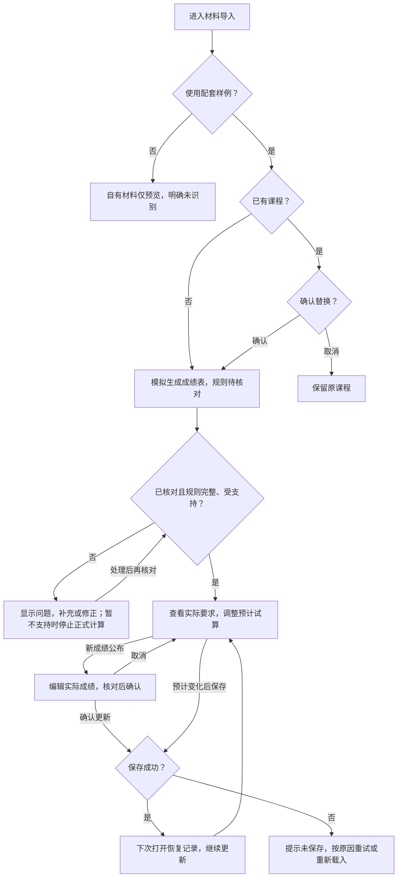

# 产品需求文档（PRD）｜课程成绩规划 Demo

从课程材料生成一份可核对的成绩表，出分前试算，出分后持续更新。

[在线体验](https://xingyuli2.github.io/ai-course-grade-planner/) · [产品案例](product-case.md) · [验证设计与证据](validation.md)

## 1. 文档信息

| 项目 | 说明 |
| --- | --- |
| 文档版本 | PRD v1.0；这是文档整理版本，不表示产品已完成全部验收 |
| 整理日期 | 2026-11-25 |
| 适用版本 | 单课程、电脑浏览器演示版 |
| 整理依据 | 现有产品实现、发起人反馈、计算规范与实际检查记录；本次在已有需求文档上补齐结构和需求编号 |
| 当前能力 | 配套材料模拟提取；计算、成绩修改确认和浏览器本地保存真实实现 |
| 当前边界 | 自己的新材料只预览；真实模型实验、同学观察及完整浏览器验收未完成 |
| 本文用途 | 定义用户任务、功能行为与验收条件；实现状态和验收证据分别记录 |

本文按已经发生的迭代整理，不将这份完整文档描述为开发前就已形成。关键决策的过程与代价见 [产品案例](product-case.md)；公式、完整 Prompt 和细节状态分别链接到对应设计文档。

## 2. 背景、问题与目标

### 2.1 问题从哪里来

项目来自发起人的算分经历：作业陆续出分时，需要找出课程考核占比、各项满分、已出成绩和额外及格要求，再向 AI 询问目标分数。下一次出分后，又要更新这些信息。

早期原型要求用户手工填写课程。将长表单分成三步后，仍然需要用户先整理材料、逐项录入。根据进一步反馈，主流程调整为“材料生成成绩表，生成后再核对与修正”。需求依据目前是个人经历与发起人反馈，同学任务观察尚未开展。

### 2.2 产品希望达到什么

| 目标 | 用户能完成的任务 | 如何判断是否达到 |
| --- | --- | --- |
| 首次使用有明确起点 | 从材料得到成绩表，核对已有结果，有错再修正 | 无需前置手工建课；能找到核对、修正与试算入口 |
| 试算含义清楚 | 分辨已出成绩与假设成绩，解释当前目标要求 | 调整预计不改变实际已获分数；能说明结果依赖哪些假设 |
| 后续出分可继续使用 | 恢复同一份记录，只更新变化的成绩 | 不重复输入已有规则与成绩；修改、取消和保存结果可理解 |

“持续记录能够减少重复整理”是待验证的产品假设。当前不设未经验证的效率提升或模型准确率成果；观察方法与现有结果在第8节分别说明。

## 3. 用户与使用场景

目标用户是课程包含多项加权考核、希望了解后续分数要求的学生。本版聚焦同一浏览器内的一门课程。

| 使用时点 | 用户已有的信息 | 想完成什么 | 对应需求 |
| --- | --- | --- | --- |
| 首次整理课程 | 评分截图或文字 | 得到可核对的项目、占比、满分和及格要求 | R01、R02 |
| 考核尚未出分 | 部分实际成绩、个人目标及假设分数 | 查看剩余整体要求，或假设下一项得分后继续试算 | R04、R05 |
| 新成绩公布或调整 | 已保存课程和新分数 | 更新对应项目，继续查看目标差距 | R03、R06 |

例如，“如果 B 拿到30分，期末需要多少”是试算；“老师公布 B 为32分”是实际记录。产品不预测学生会考多少，也不根据目标标签猜测学校的等级标准。

## 4. 需求范围与优先级

P0 表示本版核心任务必须具备；P1 表示核心流程与验收完成后再评估。优先级说明重要程度，不等于验收进度。

| 编号 | 核心需求 | 优先级及理由 | 实现状态 | 验收状态 |
| --- | --- | --- | --- | --- |
| [R01](#r01-材料导入与成绩表生成) | 材料导入与成绩表生成 | P0：首次使用的起点 | 配套材料模拟生成、自有材料预览已实现 | 自动检查覆盖部分分支；实际生成待浏览器验收 |
| [R02](#r02-核对与修正生成结果) | 核对与修正生成结果 | P0：规则错误会影响后续计算 | 核对、单独改名、规则修正已实现 | 本地一次规则确认已走查；修正路径待验收 |
| [R03](#r03-实际成绩录入修改与清除) | 实际成绩录入、修改与清除 | P0：持续更新且保护旧成绩 | 编辑草稿、核对、确认和取消已实现 | 本地首次录入确认与部分取消已走查；其他路径待验收 |
| [R04](#r04-预计成绩试算) | 预计成绩试算 | P0：允许比较不同假设 | 预计调整、清空、两类成绩隔离已实现 | 本地预计30与刷新恢复已走查；边界交互待验收 |
| [R05](#r05-目标要求与及格判断) | 目标要求与及格判断 | P0：回答还需拿多少分 | 加权、剩余要求、单项最低分判断已实现 | 已覆盖人工基准通过；部分页面结果已走查 |
| [R06](#r06-持续保存与恢复) | 持续保存与恢复 | P0：下次出分能继续使用 | 本地保存、恢复、异常保护已实现 | 本地刷新恢复已走查；关闭重开与异常路径待验收 |

P1 候选包括真实网页模型接入、多课程及本地数据备份；跨设备同步不在本轮范围，是否推进另行评估，目前没有交付承诺。独立模型实验可以先用对话工具开展，不以网页接入为前提。

本轮计算范围为100分加权总评、明确的原始满分与单项 `>=` 最低分。严格大于、去掉最低成绩、补考替代、调分曲线和复杂 OR 条件暂不支持；保留相关原文并停止正式结论，不擅自简化。完整边界见 [计算契约](calculation-spec.md)。

## 5. 主流程与关键分支

生成后的待核对记录也会尝试保存；图中集中展示更新后的保存分支。保存进度不等于确认规则，确认修改也不等于浏览器保存成功。完整异常处理见 R06。

页面分工：材料页负责选择与预览，成绩页负责核对、分数与结果，规则修正页用于生成后的纠错。实际成绩修改在弹窗内完成。正式计算前需要确认规则；在此之前可以先整理成绩。

## 6. 详细功能需求

以下验收条件描述应检查的行为，是否已经通过以第8节证据为准。

### R01 材料导入与成绩表生成

**用户目的：** 从材料得到可操作的成绩表，省去从空表建课的前置流程。

| 项目 | 需求说明 |
| --- | --- |
| 触发与前提 | 首次进入，或主动打开材料导入页；可以已有一门课程 |
| 用户操作 | 选择配套截图或文字，查看材料后点击“生成成绩表”；也可选择自己的材料预览 |
| 系统响应 | 配套样例生成后直接进入成绩页，持续显示“演示样例 / 模拟提取”，规则为待核对；尝试保存该记录 |
| 替换保护 | 已有课程时先询问是否替换；确认才生成新记录，取消保留原课程与成绩 |
| 自有材料边界 | 文字最多50,000字符；最多3张 PNG、JPEG 或 WebP 图片，单张不超过8 MB。只在当次浏览器预览，明确未识别，不提供生成按钮，也不返回固定样例答案 |
| 异常处理 | 文件类型、数量或大小超限时提示具体限制；保存失败按R06处理，不宣称数据已保存 |

验收条件：

- **R01-A1：** 配套截图、配套文字分别可生成成绩表，无前置手工填课步骤，模拟标识可见。
- **R01-A2：** 已有课程时取消替换，原规则、实际与预计成绩不变。
- **R01-A3：** 自有材料只预览且明确未识别；超限图片给出提示，不生成无关答案。

### R02 核对与修正生成结果

**用户目的：** 在正式计算前确认结果可信，有错时能够修正已有内容。

| 项目 | 需求说明 |
| --- | --- |
| 触发与前提 | 已生成或恢复课程；首次核对，或需要修改项目和规则 |
| 核对内容 | 项目名称、占比、原始满分、已出成绩、学校通过线、额外及格要求及个人目标；区分占比与满分、未知与零分、目标与通过线 |
| 用户操作 | 成绩表可直接确认规则；单独改名使用改名入口；占比、满分、及格条件与目标定义进入规则修正页 |
| 系统响应 | 单独改名要求非空，保留项目ID与成绩，不撤销既有规则确认。规则修正先形成草稿；影响计算的变化恢复待核对，正式保存检查整门课，包括未展开字段 |
| 取消与提交 | 取消或离开规则修正页，恢复原记录；正式保存校验通过后才接受草稿并重新计算，随后尝试本地保存 |
| 异常处理 | 缺失、未解决冲突或不支持规则阻止正式确认，指出问题与对应分类。未知额外要求不能当成明确没有。最终规则确认不把无效预计当成规则错误，无效预计仍阻止依赖它的试算 |

验收条件：

- **R02-A1：** 未核对时不输出正式目标倒推与通过结论；问题解决并确认后才能输出。
- **R02-A2：** 单独改名保留成绩、项目ID与确认状态；规则草稿取消后原规则恢复，正式保存不漏查隐藏分类。
- **R02-A3：** 占比合计异常、缺满分、额外要求未知或记录含不支持规则时，提示具体问题，不默默补值或删规则。

规则修正可以调整考核项目；若显式删除带成绩的项目，需要额外确认，相关最低分条件保留并要求重新选择对象。这与单独改名、修改占比的保留行为不同。程序检查的是已有记录和用户修正内容，当前不能自动读出自有新材料里的冲突。

### R03 实际成绩录入修改与清除

**用户目的：** 新成绩公布或老师调整分数后，更新这一项，同时保护持续使用的其他记录。

| 项目 | 需求说明 |
| --- | --- |
| 触发与前提 | 已有课程和考核项目；点击该项“录入”或“修改”。实际成绩默认锁定 |
| 用户操作 | 在草稿中输入新值，点击“下一步：核对分数”，查看原值与新值，再点击最终确认；核对阶段可返回修改 |
| 系统响应 | 最终确认前不改变原记录；确认后只更新本项实际值，清空本项旧预计，保留其他项目，重新计算并尝试保存 |
| 取消处理 | 编辑或核对阶段取消、按Esc，都放弃草稿，保留原实际与预计 |
| 清除与零分 | 清空输入表示恢复未出分，也必须经过核对确认；实际0分是有效记录。清除实际不恢复此前已失效的预计 |
| 异常处理 | 非数字、负分、超过满分或不符合已确认给分单位时阻止提交；原值发生变化时拒绝过期草稿。保存失败时新值可以已在页面生效，必须提示尚未保存，按R06处理 |

验收条件：

- **R03-A1：** 原值32、拟改31，取消后仍为32；最终确认才更新为31，其他项目不变。
- **R03-A2：** 未出分项带预计30，确认实际32后只清本项预计；在核对阶段取消则保持原实际与预计。
- **R03-A3：** 零分与清除分别处理；无效输入或旧值冲突不提交；保存失败不显示保存成功。

### R04 预计成绩试算

**用户目的：** 尝试不同分数假设，查看还需要达到什么要求。

| 项目 | 需求说明 |
| --- | --- |
| 触发与前提 | 已有课程，填写尚未出实际成绩项目的预计值；正式试算要求规则已确认且受支持 |
| 用户操作 | 直接填写、调整或清空预计成绩；选择只看已出成绩或加入预计的视角 |
| 系统响应 | 预计输入参与假设试算并尝试保存；实际已获总评分保持不变。已有实际成绩的项目以实际值为准，不重复计分 |
| 取消假设 | 清空某项预计后，该项在试算中恢复未知；使用清空预计操作也不能改变实际成绩 |
| 异常处理 | 预计超出满分等输入无效时提示修正，暂停依赖它的试算，保留有效的实际概览；预计零分是有效假设 |

验收条件：

- **R04-A1：** 合成样例B预计30时，实际已获仍24，目标75的期末要求为72，结果明确依赖预计。
- **R04-A2：** 清空预计后按剩余未知项重算，实际分数不变；同项有实际值时旧预计不参与。
- **R04-A3：** B满分40却预计41时，试算提示无效，实际概览仍可用；预计0不能被当成空白。

### R05 目标要求与及格判断

**用户目的：** 理解离个人目标还差多少，并知道额外及格条件是否满足。

| 项目 | 需求说明 |
| --- | --- |
| 触发与前提 | 规则已确认且受支持；选择目标或更新实际／预计成绩 |
| 用户操作 | 选择已定义的目标与计算视角；需改目标名称和分数时进入规则修正页 |
| 系统响应 | 展示实际已获总评分、差额、剩余最多可贡献分数及目标可达性。多项未知给整体加权要求；仅一项未知时倒推该项原始分数，不把所有未知项都叫期末 |
| 条件判断 | 总评目标与单项最低分分别判断；当前假设可达不等于实际达标。实际最低分未满足不能被其他高分或预计覆盖 |
| 异常处理 | 无剩余权重时不除以零；目标不可达时说明依据实际还是预计，不截成100%冒充可达。显示取整不改变内部阈值比较 |

验收条件：

- **R05-A1：** 合成样例仅A实际16时，目标75显示已获24、还差51、剩余最多70、整体约73%（向上取整）；不声称每项必须拿73%。
- **R05-A2：** B预计30时期末需72；确认实际32后实际已获40、期末需70，不重复叠加B的预计贡献。
- **R05-A3：** 总分足够但实际最低分失败时不判通过；临界分数与无剩余权重按计算契约处理。

上述算例均为合成数据：A占30%、满分20、实际16；B占20%、满分40；期末占50%、满分100且至少50分。通过线50、目标75只用于演示，不代表任何学校标准。完整人工基准和精度口径见 [计算契约](calculation-spec.md)。

### R06 持续保存与恢复

**用户目的：** 再次打开时继续更新原课程，并知道哪些内容确实已保存。

| 项目 | 需求说明 |
| --- | --- |
| 触发与前提 | 生成课程、接受规则或成绩变更、调整预计后尝试保存；在同一浏览器和地址再次打开时恢复 |
| 保存内容 | 已接受的课程规则、来源说明、实际／预计成绩和目标定义；待核对课程可以保存为待核对状态 |
| 临时内容 | 未提交规则／成绩草稿、自有材料预览、弹窗、展开区域和当前目标选择不单独保存；刷新默认选择最后一个目标，结果根据保存的输入重新计算 |
| 正常响应 | 保存成功显示状态；恢复有效记录后直接展示成绩表，无记录则进入导入页 |
| 普通保存失败 | 保留本页已接受修改，明确未保存，允许处理原因后重试；在规则草稿页重试时只能保存原已接受记录 |
| 损坏或冲突 | 损坏、未知版本或多标签冲突时保留旧存储并暂停覆盖；多标签变化在下次保存时发现，无实时同步或自动合并。此类保护不能靠重试强行覆盖 |
| 用户恢复操作 | 重新载入前确认会放弃未保存修改；清除记录前确认删除后果，不能默认替用户清理旧数据 |

验收条件：

- **R06-A1：** 成功保存后刷新或关闭再打开，规则和分数恢复，继续更新一项不丢其他成绩。
- **R06-A2：** 写入失败明确提示未保存；重试不能把未确认草稿存入；重新载入和清除需要确认。
- **R06-A3：** 记录损坏、未知版本或多标签冲突时不静默覆盖原数据，并提供处理入口。

记录只保存在当前浏览器，不跨设备、浏览器、域名或端口同步；本机版与在线版不共享数据，清理站点数据可能丢失记录。当前没有备份和原图存档能力。

## 7. AI职责与关键规则

### 7.1 提取、计算与核对的分工

| 参与者 | 职责 | 当前能力边界 |
| --- | --- | --- |
| AI提取 | 整理项目、占比、满分、成绩事实、及格条件及来源；标出缺失与冲突 | 已备Prompt与实验结构；网页只返回配套样例的固定候选，尚无真实模型输出或自动导入接口 |
| 程序 | 校验受支持的规则，确定性计算，管理修改与保存 | 已实现；字段格式正确不能证明与材料一致 |
| 用户 | 核对材料与候选结果，补充不明规则，设置目标与预计，确认实际成绩修改 | 已有操作入口；是否容易理解需同学观察 |

未来接入模型时，输出仍只是待核对候选，不能自行确认规则或直接覆盖已保存成绩；调用失败不能用无关样例冒充成功。详细输入输出约定见 [Prompt设计](prompt-design.md)，本轮不增加模型调用功能。

### 7.2 必须始终一致的规则

- 实际成绩、预计成绩与未知分别表达；空白不是零分，同项有实际值时只用实际。
- 整门课规则确认、某项成绩确认、浏览器保存成功是不同状态，不能互相替代。
- “没有读到额外要求”仍待核对；只有明确确认没有，才能按无额外条件处理。
- 个人目标与学校通过条件分开；只有一项未知时才给该项倒推，多项未知不给唯一组合。
- 页面优先展示成绩和目标，材料与规则细节按需查看；必要术语就近解释，错误指向具体项目。

详细状态与临时／持久数据划分见 [状态设计](state-design.md)。

## 8. 验收证据、未完成项与版本记录

### 8.1 需求与已有证据对应

现有自动检查合计93/93通过：计算52、存储13、成绩编辑11、应用事件14、启动3。以下需求可复用同一份证据，不重复累加数量。部分检查使用DOM与存储替身，不能代替真实浏览器或模型质量；运行环境、命令及范围见 [自动检查记录](verification-portfolio-2026-11-25.md)。

| 需求 | 自动检查依据 | 本地实际浏览器证据 | 仍待验收 |
| --- | --- | --- | --- |
| R01 | [应用事件结果](../tests/latest-app-flow-results.json)：生成、自有材料预览、替换取消 | 只查看过导入入口，未重新生成 | 截图／文字分别重新生成、材料限制、自有材料边界、替换确认与取消 |
| R02 | [应用事件结果](../tests/latest-app-flow-results.json)及[计算结果](../tests/latest-calculation-results.json)：确认、改名、规则草稿与校验 | 已有课程的一次规则确认 | 改名、修正保存／取消、隐藏字段、冲突及不支持规则页面路径 |
| R03 | [成绩编辑结果](../tests/latest-score-edit-results.json)：草稿、提交、零分、清除及冲突 | B首次录入32并确认；核对时取消录入；拟改31后核对阶段Esc取消 | 已出32最终确认改为31、编辑阶段取消、返回修改、零分／清除／越界与冲突 |
| R04 | [计算结果](../tests/latest-calculation-results.json)及应用事件结果：实际优先、预计隔离与保存 | B预计30后实际仍24、期末72，刷新预计恢复 | 无效预计、预计不可达、清空预计；同学对假设的理解 |
| R05 | [计算结果](../tests/latest-calculation-results.json)：人工基准、最低分、精度与边界 | 目标75的24／51／70／约73%，以及期末72和70 | 目标切换、不可达、最低分实际失败等页面分支 |
| R06 | [存储结果](../tests/latest-storage-results.json)及应用事件结果：恢复、失败、冲突、草稿保护 | 预计30及实际32刷新恢复 | 关闭后重开、存储失败、损坏／未知版本、多标签冲突与恢复操作 |

实际操作的范围以 [本地浏览器记录](verification-browser-2026-11-25.md)为准，后续逐项按 [浏览器清单](browser-checklist.md)执行。全部六项的线上实际交互仍未验收；Pages资源可达与代码已发布单独记录在 [发布说明](repository-release.md)。本次补写PRD不增加功能测试或验收通过项。

### 8.2 产品效果与模型质量如何补证据

| 待回答的问题 | 下一步方法 | 当前状态 |
| --- | --- | --- |
| 首次核对能否顺利开始？ | 观察同学从配套材料生成、核对、修正并进入试算，记录独立完成、求助和停顿位置 | 未开展同学观察 |
| 第二次更新是否减少重复整理？ | 让同学恢复课程并补新成绩，记录重复输入、误改、完成时间及结果解释；若对照聊天流程，保留双方可用历史信息 | 无效果数据 |
| 两种分数与及格条件是否易懂？ | 要求参与者解释哪些是实际、哪些是假设，以及总分够时为何仍需最低分条件 | 无理解率结果 |
| 模型能否忠实提取规则？ | 固定Prompt，保留首次输出，与独立人工答案逐字段比对；真实材料与合成边界例分别记录 | [5个合成案例](../evaluation/README.md)已备，真实模型实验未执行 |

模拟样例瞬间返回的时间不能用来宣称真实提取更快。具体观察与实验方案复用 [验证设计](validation.md)，结果取得后再决定是调整核对提示、改分步骤还是结果表达。

### 8.3 本次版本记录

| 日期 | 文档版本 | 本次调整 |
| --- | --- | --- |
| 2026-11-25 | PRD v1.0 | 在原需求文件内补齐六项编号需求、主流程分支、统一详述与验收证据关联；未改变产品范围或实现 |

后续更新同步记录需求行为和验收状态；需求文字变更不代表功能已经实现，补充证据也不自动代表所有场景通过。
