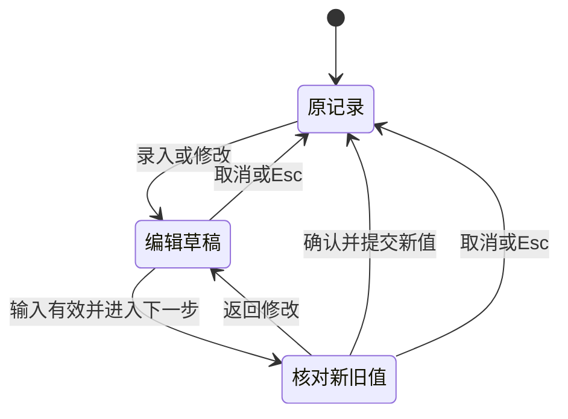

# 状态设计：课程分数规划 Demo

更新：2026-11-25。对应 [页面实现](../dist/app.mjs)、[计算模块](../dist/calc.mjs)、[存储模块](../dist/storage.mjs) 与 [成绩提交模块](../dist/score-edit.mjs)。

## 1. 为什么需要状态管理

课程分数规划 Demo 通过状态管理连接评分规则提取、目标试算与分数持续更新。当前规则提取采用配套材料的模拟结果；首次生成课程、核对规则、填写预计、录入实际成绩、再次打开，各阶段允许的操作不同。

如果只保留输入框里的值，容易把未确认的修改提前保存、把预计当作实际，或在规则尚未核对时给出正式结果。状态设计需要明确三件事：当前记录可信到什么程度、哪些变更已经生效、哪些内容需要保留到下次使用。

## 2. 当前 Demo 的核心状态

### 2.1 页面与导入状态

| 字段 | 作用 |
| --- | --- |
| `activeView` | 在 `import`、`dashboard`、`rules` 三个页面区域间切换 |
| `importKind` | 区分配套截图、配套文字和自己的材料 |
| `importText`、`uploads` | 保存当次输入的文字与图片预览 |
| `replacement` | 保留待确认的替换动作；取消时不替换当前课程 |

无课程时进入材料页；有合法记录时恢复成绩表。配套样例生成后直接进入成绩表。自己的材料只预览，没有真实提取请求。

### 2.2 课程与规则状态

`course` 包含课程名称、材料说明、考核项目、目标、通过线、额外及格要求及待处理规则。`sourceMode: "sample"` 对应“演示样例 · 模拟提取”；`manual` 为旧记录与测试保留的兼容字段。

| `ruleStatus` | 含义 | 页面行为 |
| --- | --- | --- |
| `pending` | 已生成但未核对，或规则发生修改 | 展示成绩表与待核对问题，暂停正式计算 |
| `confirmed` | 已核对且完整校验通过 | 提供目标与及格结果 |
| `unsupported` | 存在当前不能处理的规则 | 保留规则原文，提示暂不支持，暂停正式计算 |

额外及格要求用 `hurdleStatus` 单独记录：`unknown` 表示还不确定；`none` 表示已确认没有；`confirmed` 表示有明确条件。没看到要求不能自动变成没有要求。

### 2.3 实际与预计成绩

每个考核项目有稳定 `id`，并分别保存 `actual` 与 `expected`。空字符串表示未知，`"0"` 表示明确零分。

| 项目情况 | 只看已出成绩 | 加上预计成绩试试 |
| --- | --- | --- |
| 实际有值 | 只使用实际 | 只使用实际，旧预计不再参与 |
| 实际空，预计有值 | 仍是未知项 | 使用预计并标注假设 |
| 两者都空 | 未知项 | 未知项 |
| 实际空，预计无效 | 忽略预计，实际结果仍可计算 | 提示修正预计，暂停试算 |

`mode` 控制当前计算视角。`selectedTargetId` 控制当前显示的目标；目标定义保存在课程中，选中状态不单独保存，刷新默认选择最后一个目标。

### 2.4 修改草稿

规则修改用 `ruleBackup` 保留进入编辑前的课程，当前 `course` 副本作为草稿。保存时校验整门课，接受后清除备份；取消或离开修正页恢复原课程。

成绩修改用 `scoreEdit` 保存项目 ID、打开时的实际旧值、草稿新值和是否已核对。输入阶段只改草稿，核对并确认后才更新课程。

### 2.5 保存状态

`storageProblem` 表示读取、写入或冲突问题。页面显示“已保存”必须来自成功保存结果；写入失败时说明当前修改仍只在页面内，不能把页面变化当作持久化成功。

## 3. 派生状态

总分、差额、最高可能总评、未知项目、试算假设和单项最低分状态，由 `calculateCourse(course, mode)` 根据课程输入即时计算，不额外保存一份结果副本。

这样在某项成绩更新后，相关结果都由同一份记录重新得到，避免界面同时出现新分数和旧结论。

例如合成样例中，A 已贡献 24 分；B 预计 30/40 时，预计贡献为 15，目标 75 对应期末 72/100。B 实际确认 32/40 后，实际贡献合计变为 40，期末要求重新计算为 70/100。两种结果不能叠加。

## 4. 状态如何保护成绩与计算结果

### 4.1 未确认规则不进入正式计算

新生成的课程保持 `pending`。用户核对后仍要通过字段与规则校验，才能转为 `confirmed`。缺失满分、权重异常、未明确门槛或不支持规则不能靠点击确认绕过。

### 4.2 已出成绩确认后才更新



提交前检查分数范围、给分单位和旧值是否变化。提交只替换目标项目的实际成绩并清空本项预计，其他成绩保持不变。清空实际输入意味着恢复未出分，也必须经过核对确认；取消保留实际与预计原值。

### 4.3 条件性结果不写成实际结果

“实际已获得总评分”始终只来自实际成绩。预计达标必须带假设说明；实际单项最低分失败不能被预计或其他高分覆盖。总分目标、额外要求和课程通过条件分别呈现。

## 5. 当前交互状态流

```text
页面打开
→ 读取本地记录
→ 无记录：进入导入页；有合法记录：进入成绩表
→ 配套材料生成候选课程，规则待确认
→ 核对或按需修正，完整校验通过后确认
→ 修改预计，保存输入并重新计算试算结果
→ 实际出分，编辑草稿、核对新旧值、确认提交
→ 清空该项旧预计，重新计算并保存课程
→ 下次打开恢复同一份记录
```

再次生成前有替换确认。存储被阻止时仍显示问题和处理入口，不无声覆盖旧记录。

## 6. 课程数据结构

| 层级 | 关键字段 | 设计用途 |
| --- | --- | --- |
| 课程 | `name`、`sourceMode`、`sourceText`、`notes` | 展示课程与材料来源 |
| 规则状态 | `ruleStatus`、`unresolvedText`、`unsupportedText` | 保留未确定与未支持内容 |
| 考核项目 | `id`、`name`、`weight`、`max`、`actual`、`expected`、`step`、`source` | 将规则、分数和来源关联到同一项目 |
| 总分要求 | `passMark`、`targets[]` | 区分课程及格线与个人目标 |
| 单项要求 | `hurdleStatus`、`hurdles[]` | 记录对象、运算符、阈值、单位与来源 |

数值在输入和保存时使用十进制字符串；计算时转换为精确分数。项目改名保留 `id`，不会把成绩或最低分关联到另一个项目。详细字段见 [计算类型说明](calculation-types.md)。

## 7. 持续记录与临时信息

| 信息 | 是否持久保存 | 原因 |
| --- | --- | --- |
| 已接受的课程、规则、实际与预计、目标定义 | 是 | 下次出分时继续更新 |
| 待核对但结构合法的生成结果 | 是 | 保留已生成课程，不等于规则已确认 |
| 正在编辑但未提交的规则／成绩草稿 | 否 | 取消时恢复已接受记录 |
| 当前选中的目标、展开区域和弹窗 | 否 | 属于当前页面操作状态 |
| 自有材料的图片预览 | 否 | 只在本次打开时显示，不承诺原图存档 |
| 计算结果 | 否 | 由已保存输入重新计算 |

本地记录使用 `course-grade:v1` 键，包含版本 `schemaVersion: 1`、课程数据和保存时间。不同浏览器、域名或端口不共享记录，清理站点数据会丢失记录；目前没有云同步和备份。

## 8. 后续模型接入的状态边界

[规则提取 Prompt](../prompts/extract-rules.md) 已定义候选结构，但尚未连接网页，也未执行真实模型实验。

如果后续接入模型，提取结果只能处于待核对或暂不支持状态。来源中出现某项要求，不等于用户已确认；提取过程不能自动改为 `confirmed`，也不能替学生写入实际成绩或计算通过结论。

缺失、冲突及超范围规则需要保留，核对后才进入现有计算与保存流程。请求失败或输出不可用时应显示对应问题，不能回退成与材料无关的样例成功结果。这些是后续接入要求，不是当前已完成能力。

## 9. 异常状态与处理

| 事件 | 当前处理 | 用户看到什么 |
| --- | --- | --- |
| 没有旧记录 | 正常进入导入页 | 尚无课程，不自动生成 |
| 记录损坏、格式不符或版本未知 | 暂停自动保存并保留原记录 | 读取失败与处理提示 |
| 存储空间或权限不足 | 保留页面内修改，允许处理后重试 | 明确未保存 |
| 其他标签页已更新记录 | 比较读取时的原始记录，暂停覆盖 | 提示重新载入最新记录 |
| 成绩弹窗打开后旧值已变化 | 拒绝覆盖较新成绩 | 提示重新核对 |
| 修正规则时重试保存 | 保存原已接受课程 | 修正内容仍为草稿 |
| 替换课程或修改成绩后取消 | 不提交待执行变更 | 原记录保持不变 |

## 10. 状态验收

重点检查规则何时确认、预计是否改变实际总分、改分何时生效、取消是否恢复，以及下次打开是否保留正确记录。

现有 [计算测试](../tests/calculation.test.mjs)、[存储测试](../tests/storage.test.mjs)、[成绩编辑测试](../tests/score-edit.test.mjs) 和 [应用事件检查](../tests/app-flow-smoke.mjs) 覆盖对应逻辑。事件与存储替身不验证原生弹窗、焦点、真实刷新恢复和排版；这些按 [浏览器清单](browser-checklist.md) 继续验收，当前完整浏览器检查未完成。

本轮已实际走查预计30刷新恢复、实际32确认、核对取消及Esc后刷新仍32，见 [浏览器记录](verification-browser-2026-11-25.md)。其余异常与交互路径继续按清单核对。
