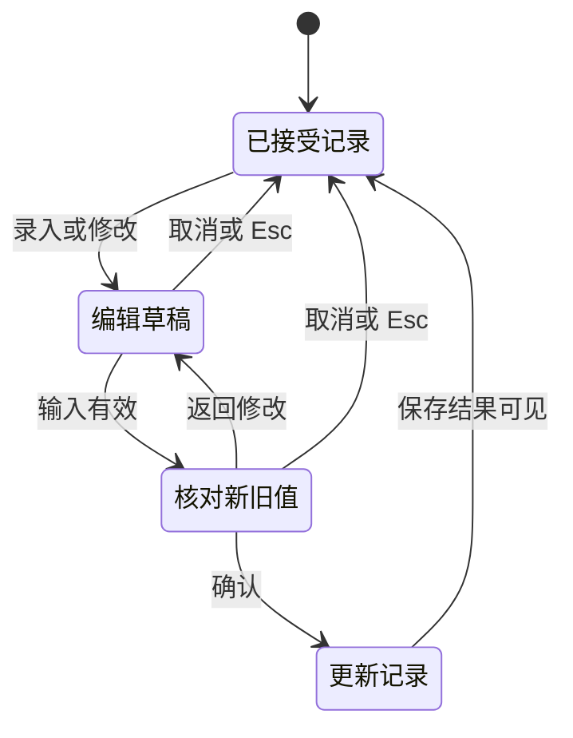

# 状态设计：让分数更新可控

课程成绩规划 Demo 需要持续使用：今天填一个预计分数，下周录入老师公布的实际成绩，之后还可能更正。状态设计要让用户分清：**哪些是事实、哪些是假设、哪些还没确认、哪些已经保存。**

本文描述当前网页行为。配套材料使用“模拟提取”；自己的新材料只预览。对应实现为 [页面交互](../dist/app.mjs)、[成绩提交](../dist/score-edit.mjs) 和 [本地保存](../dist/storage.mjs)。

## 1. 先看一次成绩更新

合成演示课程中，作业 A 已出成绩为 16/20，B 满分 40、占比 20%。目标总评 75 时，下面几步的含义不同：

| 用户动作 | 记录发生什么变化 | 结果应该怎样解释 |
| --- | --- | --- |
| B 填预计 30 | 保存为预计；B 实际仍为空 | 实际已获仍为 24 分，按该假设期末需 72 分 |
| 打开 B 的实际成绩录入，输入 32 | 只形成修改草稿 | 原记录还没变，不能提前把 32 计入实际总分 |
| 核对“未出分 → 32”并确认 | B 实际变为 32，本项预计清空；尝试保存 | 实际已获变为 40 分，期末需 70 分 |
| 再拟改为 31，但取消 | 放弃草稿 | B 仍为 32，A 仍为 16 |
| 保存成功后刷新 | 恢复同一份课程 | 保留已确认的 32，不恢复放弃的 31 |

分数示例来自 [计算契约](calculation-spec.md)。这些核心操作已有[本地浏览器走查记录](verification-browser-2026-11-25.md)，不能据此视为所有异常或线上交互都已验收。

## 2. 规则、成绩和保存分别判断

“已经保存”只说明浏览器记住了记录，不代表规则已经核对；“规则已确认”也不保证这次修改成功写入浏览器。

| 需要区分的状态 | 含义 | 当前行为 |
| --- | --- | --- |
| 规则待核对 `pending` | 刚生成，或正在修正规则 | 展示成绩表与具体问题，暂停正式目标结果 |
| 规则已确认 `confirmed` | 用户核对，且程序校验通过 | 按当前规则计算 |
| 规则暂不支持 `unsupported` | 存在超出计算范围的规则 | 保留原文并提示，暂停正式计算 |
| 已出成绩 `actual` | 老师已经公布的分数 | 默认锁定；录入、修改、清除都需核对并确认 |
| 预计成绩 `expected` | 用户用来试算的假设 | 未出分项可直接调整或清空，自动尝试保存 |
| 修改草稿 | 输入了新值，但还未接受 | 不覆盖原已接受记录，取消可恢复 |
| 保存成功／失败 | 是否写入当前浏览器 | 成功显示保存状态；失败说明修改仍只在页面中 |

额外及格要求另有三种状态：不知道有没有（`unknown`）、已确认没有（`none`）、已有明确条件（`confirmed`）。即使样例已填好最低分条件，整门课仍要完成规则核对；“没看到要求”不能自动当作没有要求。

## 3. 为什么实际与预计要分开

如果共用一个分数输入框，学生很容易忘记某个数字只是自己的假设，或在实际出分后把两个分数重复计算。

| 同一考核的记录 | 只看已出成绩 | 加上预计成绩试试 |
| --- | --- | --- |
| 有实际成绩 | 使用实际 | 仍使用实际，旧预计失效 |
| 没有实际，有预计 | 作为未出分项目 | 使用预计，并说明假设 |
| 两者都空 | 未知 | 未知 |
| 实际为空，预计无效 | 忽略预计，保留实际视角结果 | 提示修正预计，暂停试算 |

空白代表没出分，`0` 代表确实得了零分。预计变化不能改变“实际已获得总评分”；总评达到目标与单项最低分要求是否满足也分别判断。只有预计达标时，结果必须注明“按当前假设”。

## 4. 修改何时生效

### 已出成绩：先输入，再核对新旧值

确认前检查分数范围、已设置的给分单位，以及弹窗打开后的原值是否变化。确认只更新对应项目，并清空本项预计；其他项目成绩保持不变。清空实际值表示恢复未出分，也走同一核对流程，不自动恢复旧预计。

这个选择增加一次确认动作，换来更清楚的生效时点。预计成绩常要反复试，不使用同样的确认门槛；已出成绩是持续记录的依据，需要更谨慎。

### 规则：生成后修正，保存时检查整门课

首次生成后直接展示成绩表。用户可以核对后确认，也可以进入修正页改占比、满分或及格条件。修正期间保留原课程备份；取消或离开修正页会恢复原记录。

点击保存时检查整门课，包括未展开的字段。缺失、冲突待处理或不支持的规则会阻止确认，不会因为切换了栏目而略过。规则保存通过后才接受新课程并重新计算。修正页中的“重试保存”只保存原记录，不让草稿提前生效。

项目名称可单独修正，保留稳定项目 ID 和成绩；这不触发整套数值规则的重新确认。修改占比、满分等计算规则则需要重新核对。

### 课程替换：先确认，再覆盖

有课程时再次生成样例，会先询问是否替换。取消保留原课程；确认才使用新样例。自己的新材料没有生成入口，不会触发与材料无关的固定结果。

## 5. 哪些内容下次打开还在

| 信息 | 是否保存到浏览器 | 理由 |
| --- | --- | --- |
| 已接受的规则、实际／预计、目标定义和来源说明 | 是 | 下次只更新新成绩，无需重新整理 |
| 刚生成但尚未核对的课程 | 是，保留待核对状态 | 保存进度与确认规则是两件事 |
| 未提交的规则／成绩草稿 | 否 | 避免误把临时输入变成正式记录 |
| 自有材料的文字和图片预览 | 否 | 仅用于当次预览，没有原图存档能力 |
| 当前目标选择、展开区域与弹窗 | 否 | 属于临时操作；刷新默认选最后一个目标 |
| 总评、差额、期末要求 | 否 | 每次根据输入重新计算，避免新成绩配旧结果 |

课程记录存于 `localStorage`，带格式版本和保存时间。当前保存一门课程，不提供云同步或备份；不同浏览器、域名和端口不共享记录，清理站点数据会丢失记录。

实现中，`course` 保存已接受课程或正在编辑的副本，`ruleBackup` 保留规则编辑前的记录，`scoreEdit` 保存实际成绩草稿，`storageProblem` 表达保存问题。更多字段见 [计算类型说明](calculation-types.md)，无需把界面全部状态交给模型记忆。

## 6. 异常发生后如何继续

| 情况 | 当前处理 | 对用户的意义 |
| --- | --- | --- |
| 没有保存记录 | 进入导入页 | 不自动生成一门课程 |
| 旧记录损坏、格式不符或版本未知 | 保留旧记录，暂停自动覆盖 | 显示读取问题，提供处理入口 |
| 浏览器存储不可用或空间不足 | 保留本页修改，显示未保存并允许重试 | 此时关闭页面可能丢失修改，不能宣称下次一定恢复 |
| 其他标签页已更新课程 | 下一次保存时发现变化，停止覆盖 | 提示重新载入最新记录；没有自动合并能力 |
| 成绩草稿对应的原值已变化 | 拒绝提交过期草稿 | 重新核对最新值，避免覆盖较新成绩 |
| 重新载入或清除记录 | 先说明后果并确认 | 重新载入放弃未保存修改；清除会删除本工具本地记录 |

确认修改与保存成功是两个时点。当前页面已经采用新成绩但存储失败时，提示会明确区分两者。代码也对未提交草稿或未保存修改设置离开页面提示；浏览器实际提示、焦点与键盘表现仍需按清单验收。

## 7. 当前证据与后续边界

[自动检查记录](verification-portfolio-2026-11-25.md)包含存储、成绩编辑和应用事件检查。它们验证已覆盖的逻辑；替身不会验证真实浏览器的原生弹窗、排版或权限表现。完整路径继续按 [浏览器清单](browser-checklist.md)检查，线上交互验收尚未完成。

后续若接入模型，候选结果仍只能是待核对或暂不支持，不能自动确认规则或覆盖已保存成绩。请求失败、输出不可用时需要明确提示，不能以无关样例冒充成功。候选格式校验与转换接口尚未实现，详见 [Prompt 设计](prompt-design.md)；当前的持续记录来自程序与本地存储，不代表模型具有记忆能力。
