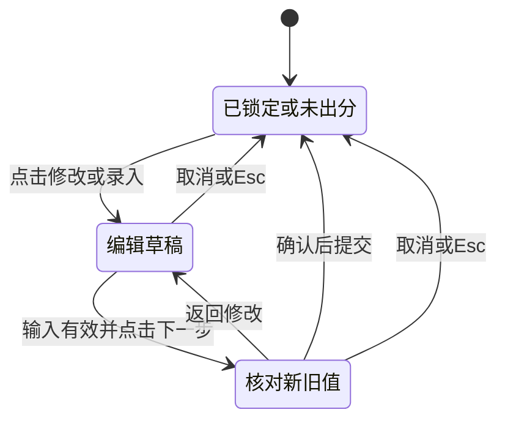

# 状态与数据保护设计

更新：2026-11-25。本文对应现有 [页面实现](../dist/app.mjs)、[计算模块](../dist/calc.mjs)、[存储模块](../dist/storage.mjs) 和 [成绩提交模块](../dist/score-edit.mjs)。这里的“状态”是系统目前可以显示、计算或保存什么，不是模型记忆或 Agent 能力。

## 哪些内容保存，哪些只在当前页面

| 数据 | 当前表示 | 保存与使用 |
| --- | --- | --- |
| 课程、考核与规则 | `course`；项目用稳定 `id` 关联 | 经接受的课程保存；改名不更换 ID |
| 已出成绩 | `items[].actual` | 空字符串表示未出分，`"0"` 表示实际零分；提交确认后更新 |
| 预计成绩 | `items[].expected` | 直接编辑并保存，只影响试算 |
| 个人目标 | `targets[]` | 保存目标定义；当前选中目标 ID 属于界面状态，刷新默认选最后一个目标 |
| 规则修正草稿 | `course` 的当前副本及 `ruleBackup` | 正式保存前保留原记录；取消恢复备份 |
| 成绩修改草稿 | `scoreEdit` | 包含旧值、新值、项目 ID、是否已核对；确认前不改课程 |
| 原始图片预览 | `uploads` / 临时对象 URL | 只当次可见，不作为图片持久保存或上传 |
| 总分、剩余要求、通过状态 | `calculateCourse` 派生结果 | 按当前课程重新计算，不单独维护一份成绩结论 |

存储键为 `course-grade:v1`，记录包含 `schemaVersion: 1`、课程和保存时间。同一浏览器的不同域名或端口是不同存储区域；本地记录不会随 GitHub 代码上传而迁移。

## 材料和规则状态

配套样例有 `sourceMode: "sample"`，界面显示“演示样例 · 模拟提取”。旧存储兼容值 `manual` 只用于读取已有记录，不代表新用户需要手动建课。自有新材料仍停留在预览状态，没有真实模型请求，也没有将它转换为样例规则。

| `ruleStatus` | 何时出现 | 允许的行为 |
| --- | --- | --- |
| `pending` | 新生成、尚未核对或规则改动 | 展示和修正成绩表；暂停正式目标计算 |
| `confirmed` | 用户核对且完整校验通过 | 计算目标与及格要求；确认按钮不能绕过缺失和未支持规则 |
| `unsupported` | 已记录当前不能处理的规则 | 保留原文并提示处理；暂停正式计算 |

额外及格要求的 `hurdleStatus` 独立表示 `unknown`、`none`、`confirmed`。“没找到要求”保持未知；只有明确确认无额外要求，才按空列表计算。独立模型 Prompt 的 `present_in_source` 等来源状态不是网页已确认状态，不能直接互换。

规则修正：进入页面复制原课程 → 编辑当前副本 → 保存时验证整门课 → 成功后接受副本并保存。取消或离开修正页恢复原课程；存储失败后的“重试保存”仍使用原已接受记录，不能顺便提交未确认的规则草稿。

## 已出成绩的两阶段操作

清空输入代表恢复为未出分，也要核对并确认。提交前检查分数范围、计分单位和旧值是否变化；提交只替换对应项目的实际值并清空该项预计，其他项目不变。取消不会提交草稿。

“页面已更新”和“已经保存到浏览器”仍是两件事。若写入失败，页面保留当前修改并提示未保存，不能显示保存成功。焦点、Esc、原生弹窗及真实刷新恢复需要浏览器操作证据，不能仅由模块调用证明。

## 实际视角与试算视角

| 项目内容 | 只看已出成绩 | 加上预计成绩试试 |
| --- | --- | --- |
| 实际有值，无论是否残留预计 | 只使用实际 | 只使用实际 |
| 实际为空，预计有值 | 仍视为未知 | 使用预计并标注假设 |
| 两者都空 | 未知 | 未知 |
| 预计无效、实际为空 | 忽略预计，实际结果仍可用 | 提示修正预计，暂停试算 |

两个视角中的“已拿到的总评得分”都只来自实际。总评目标、每项最低分与整门课通过条件分别计算：实际最低分失败不能被其他高分或预计分覆盖；预计失败只能描述当前假设；总分可达也不等于已经通过。

## 保存异常

| 事件 | 当前处理 | 用户应看到的结果 |
| --- | --- | --- |
| 没有旧记录 | 显示材料导入 | 不自动生成课程 |
| 有合法版本记录 | 恢复课程 | 直接进入成绩表 |
| JSON 损坏、格式不符、未知版本 | 暂停自动覆盖 | 原记录保留，显示处理提示 |
| 存储空间不足或权限限制 | 保留页面内修改 | 明确未保存，可处理后重试 |
| 另一个标签页更新 | 比较读到的原始记录，暂停覆盖 | 提示载入最新记录 |
| 再次生成样例 | 先显示替换确认 | 取消保留原课程 |

本地存储没有云备份，清理站点数据会丢失记录。现有保护不能保证所有浏览器和设备都已验收，实际覆盖范围见 [检查记录](verification-import-demo-2026-11-25.md)。

## 证据入口

[计算测试](../tests/calculation.test.mjs) 覆盖实际/预计、零分/未知及门槛边界；[存储测试](../tests/storage.test.mjs) 覆盖版本和冲突；[成绩编辑测试](../tests/score-edit.test.mjs) 覆盖提交与其他成绩保留；[应用事件检查](../tests/app-flow-smoke.mjs) 使用 DOM 和存储替身执行实际处理器。它们支持各自范围，真实浏览器交互按 [清单](browser-checklist.md) 单独记录。
